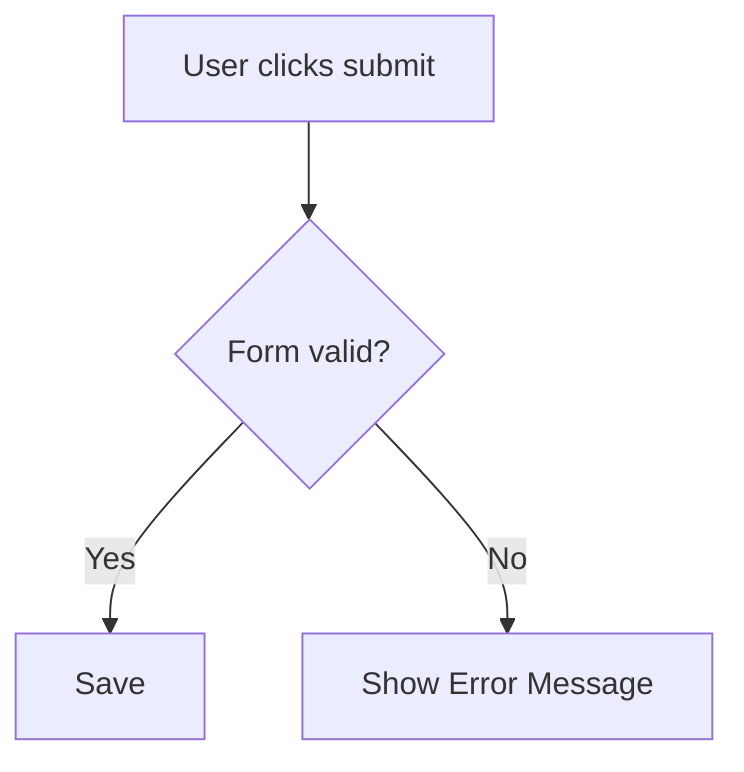

# 規格書撰寫標準 (Specification Standard)

> 規範企劃產出的 PRD 或 User Story 的結構與內容要求。
> 文件以 Markdown 撰寫,後續可導出為 HTML 發布。
> **可切片性(§1.7)是硬要求** — 規格必須能被下游任務逐節引用,這是防止開發 AI 通讀整份 Spec 導致上下文爆炸的前提。

---

## 1. 核心組成要件

每一份規格書(無論大小)都必須包含以下核心區塊。**每個小節、每條規則、每條 AC 都要有編號**,供 Task Backlog 逐條引用。

### 1.1 背景與目標 (Background & Objectives)
- **Why**:為什麼要做?解決什麼業務痛點?
- **Success Metrics (KPIs)**:上線後如何衡量成功?(如:減少 20% 客訴、提高轉化率)。

### 1.2 目標受眾 (Target Audience / Personas)
- 這個功能做給誰用?(如:一般使用者、後台管理員、特定層級主管)。

### 1.3 核心使用者流程 (User Flow / User Story)
- User Story 格式:`As a [role], I want to [action], so that [benefit].`
- **每條 Flow 給編號**(Flow-A、Flow-B…),步驟內再編號(step1、step2…),供任務切片精準指向。
- 搭配高階步驟描述使用者操作路徑;鼓勵 Mermaid 流程圖。

### 1.4 業務規則與限制 (Business Rules & Constraints)
- **每條規則給編號**(R1、R2…):限制條件(如:密碼須英數且 > 8 碼、資料保留 90 天)。
- 權限控管:誰可讀?誰可改?

### 1.5 邊界條件與例外處理 (Edge Cases & Exception Handling)
- 網路斷線、API 逾時、輸入無效、無權限時的系統行為與錯誤訊息。
- 空狀態 (Empty State) 的呈現方式。

### 1.6 驗收條件 (Acceptance Criteria, AC)
- 必須可驗證、客觀。**每條 AC 給編號**(AC-1、AC-2…)。
- 推薦 BDD 格式:
  - **Given**:前置條件。
  - **When**:執行動作。
  - **Then**:預期結果。

### 1.7 任務切片約定 (Task Slicing Convention) ★新增

> 目的:讓 `delivery-planner` 能把 Spec 切成 TASK,並讓每顆 TASK 標出「只需讀哪幾節」。這是**下游上下文預算**的來源。

- **可定址**:每個小節(§1.3~§1.6)內的 Flow / R / AC 都有唯一編號,任務可用「§1.4 R2」「§1.6 AC-3~5」精準引用。
- **高內聚分節**:相關的 Flow + Rule + AC 盡量集中,讓一顆 TASK 對映的切片連續、好載入。
- **避免跨節糾纏**:同一業務結果的規則不要散落在多個遠端小節;若不可避免,在該處交叉註明(如「另見 §1.5 斷線處理」)。
- **切片自檢**:寫完 Spec,自問「delivery-planner 能不能只讀某幾節就切出一顆完整 TASK?」若不能,重整分節。

> 產出 Task Backlog 的完整標準見 `rules/task-planning.md`;交接契約見 `rules/handoff-contract.md`。

---

## 2. 撰寫風格與排版

1. **結構化**:善用標題(H1–H3)與條列,避免文字牆(文字牆也更耗下游 token,見 `context-discipline.md` §4)。
2. **無歧義**:用詞精準。用「必須 (Must)」「可以 (May)」界定強制性,避免「應該」「可能」。
3. **視覺化輔助**:鼓勵用 Mermaid 繪流程圖、狀態機圖。

---

## 3. HTML 導出約定

- 規格以純 Markdown 撰寫,確保 Git 上的易讀性與版本追蹤。
- **HTML 為選用產物,非企劃人員手刻**:需分享給非技術團隊時,透過 CI/CD 或轉檔工具(如 `pandoc`、Markdown → HTML 腳本)產生,套用公司統一 CSS。
- **現況說明(避免過度承諾)**:本工作區**尚未內建**轉檔腳本;`/write-prd` 預設只保證 Markdown 產出,HTML 為「需要時再轉」的選配步驟。若團隊要常態導出 HTML,應另建轉檔 skill/腳本,不要求 BA 在對話裡手刻 HTML 標籤。

---

## 4. 相關規則

| 主題 | 位置 |
|------|------|
| 企劃生命週期步驟 | `rules/planning-workflow.md` |
| 任務拆解 / backlog / DAG | `rules/task-planning.md` |
| 交接契約 / OQ 生命週期 | `rules/handoff-contract.md` |
| 上下文與 token 紀律 | `rules/context-discipline.md` |
